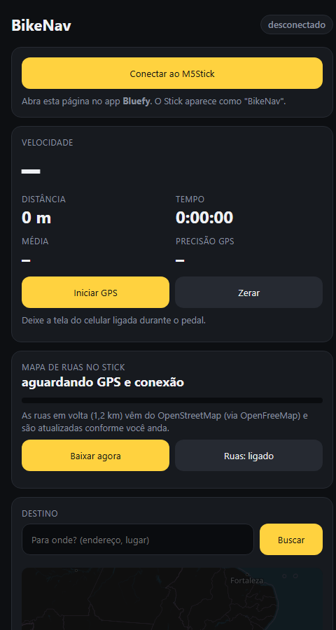

# M5 Nav

Painel de rota GPS para bike com o **M5StickC Plus**. O celular usa o GPS e manda posição, rota e mapa de ruas por **Bluetooth (BLE)**; o Stick no guidão mostra a trilha, a velocidade e a distância.

## O que faz

- Velocidade, distância, tempo em movimento e média.
- Rota até um destino buscado pelo endereço, desenhada no Stick.
- Mapa de ruas em volta (OpenStreetMap via OpenFreeMap), atualizado enquanto você anda.
- Visão 2D/3D, zoom automático e ajuste de brilho.

## Estrutura

- `firmware/`: código do Stick (PlatformIO, M5Unified + NimBLE).
- `web/`: página que roda no celular e conversa com o Stick por Web Bluetooth.

## Como usar

1. Grave o firmware: `cd firmware && pio run -t upload`.
2. Abra a página `web/index.html` hospedada em HTTPS (no iPhone, use o app **Bluefy**).
3. Toque em **Conectar ao M5Stick** (ele aparece como "BikeNav") e depois em **Iniciar GPS**.

**Botões no Stick:** A troca de tela (segurar: 2D/3D) · B muda o zoom (segurar: brilho).

## Licença

[MIT](LICENSE)
